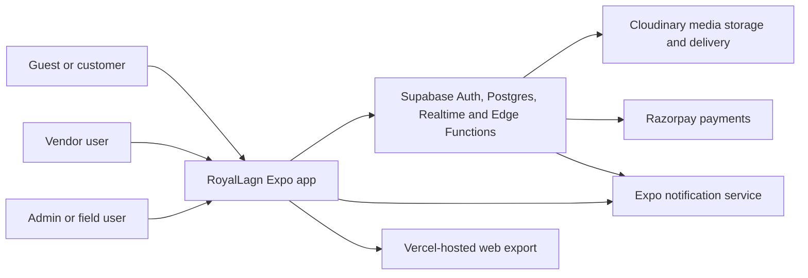
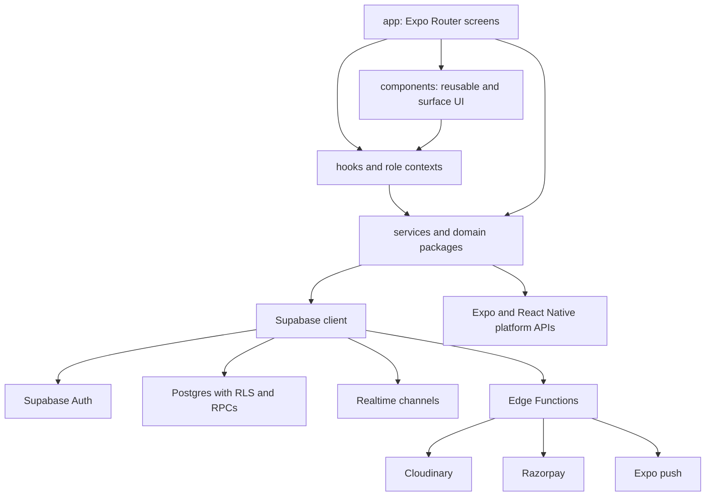
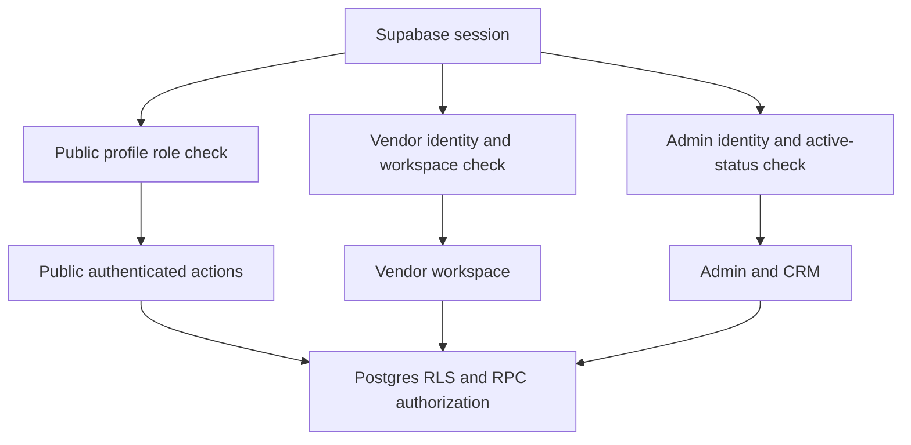
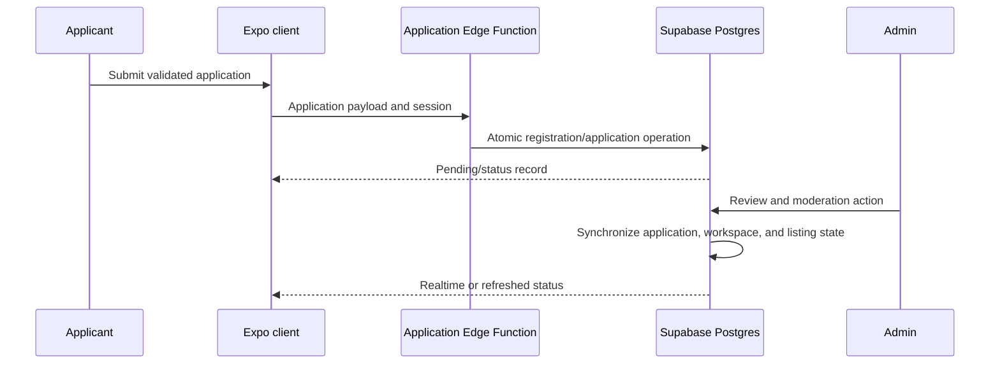
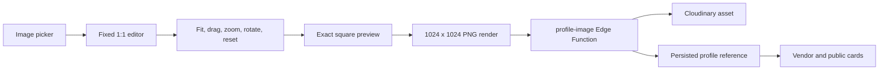
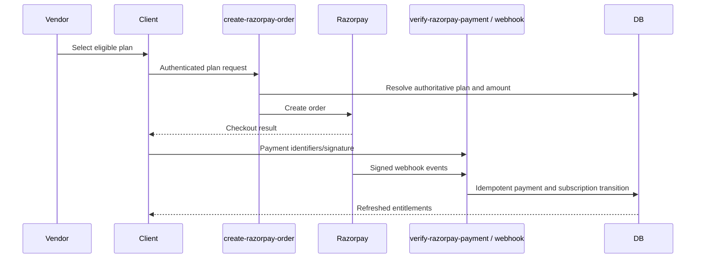

# RoyalLagn System Architecture

| Field | Value |
|---|---|
| Status | Current architecture reference |
| Version | 1.0 |
| Last verified | 2026-08-08 |
| Scope | Expo clients, domain layers, Supabase backend, external integrations |

This document describes the implemented architecture and its governing constraints. Product intent is defined in [PRD.md](PRD.md), testable behavior in [SRS.md](SRS.md), UI rules in [DESIGN.md](DESIGN.md), and contributor rules in [AGENTS.md](AGENTS.md).

## 1. Architecture goals

- Deliver public, vendor, and admin experiences from one cross-platform codebase.
- Keep role authorization separate even though all roles use one Supabase project.
- Centralize business access in services and domain packages instead of route components.
- Make Supabase Postgres and server-verified state authoritative.
- Keep secrets and privileged integrations outside the shipped client.
- Propagate vendor/content changes to every relevant surface with predictable refresh and realtime behavior.
- Support incremental feature delivery without replacing established routing, styling, or state patterns.

## 2. System context



The Expo application is an untrusted client. Supabase Auth establishes identity; Postgres RLS, grants, RPCs, and Edge Functions enforce authorization. Cloudinary and Razorpay secrets exist only in server-side environments.

## 3. Technology baseline

| Layer | Technology |
|---|---|
| UI runtime | Expo SDK 54, React Native 0.81, React 19 |
| Navigation | Expo Router 6 with typed file-based routes |
| Styling | NativeWind 4, Tailwind 3, shared design tokens/components |
| Client state | React Context and domain hooks |
| Backend | Supabase Auth, Postgres, Realtime, Edge Functions |
| Media | Expo Image Picker/Manipulator, Cloudinary, native view capture, web canvas |
| Video | Expo Video plus the self-contained `clips/` domain |
| Payments | Razorpay client SDK with server-created and verified transactions |
| Notifications | Expo Notifications plus Supabase inbox/delivery records |
| Web delivery | Expo static export and Vercel SPA rewrite |
| Native delivery | Expo/EAS and generated Android/iOS workspaces |

Versions in `package.json` and platform configuration in `app.json`/`eas.json` are authoritative.

## 4. Logical architecture



### 4.1 Presentation and routing

`app/` is the route boundary. Each file maps to a screen/URL:

- `app/(tabs)/` contains the public mobile tab group.
- unprefixed routes such as `Search.tsx`, `VendorsListing.tsx`, and `vendors/[slug].tsx` serve the public experience.
- `Vendor*.tsx` and vendor dashboard routes serve vendor workflows.
- `Admin*.tsx`, admin dashboard routes, and `Crm*.tsx` serve operational and field workflows.

Route components orchestrate presentation and domain hooks. New database logic should not be embedded directly in a screen when an existing service can own it.

### 4.2 Reusable UI

`components/` is grouped by cross-cutting or feature purpose:

- public discovery: `home/`, `categories/`, `listing/`, `vendor-profile/`, `favorites/`, `reviews/`;
- vendor: `vendor/`, `packages/`, `vendor-marketing/`, `vendor-marketing-card/`;
- admin and CRM: `admin/` and its nested feature groups;
- shared behavior: `auth/`, `responsive/`, `animated/`, `loading/`, `locations/`, and notification registration.

Shared UI follows `DESIGN.md`, `constants/typography`, palette tokens, and responsive primitives. Platform-specific files use `.web.tsx` or `.native.tsx` only when platform APIs or interaction models genuinely differ.

### 4.3 Context and hooks

Contexts hold session-wide client state, not authoritative server rules. Existing contexts cover:

- public, vendor, and admin identity/session concerns;
- categories and locations;
- favorites and review ratings;
- public/vendor notifications;
- subscriptions;
- admin dashboard state; and
- responsive layout.

Hooks compose services for screens and components. A new global state library must not be introduced for a domain already served by these patterns.

### 4.4 Services and domain packages

`services/` owns Supabase queries, RPC invocation, external integration adapters, mapping, and business orchestration. Important service groups include public listings, vendor profile/public profile, applications, portfolio, packages, enquiries, reviews, admin operations, push notifications, marketing cards, and CRM.

Three larger domains are deliberately self-contained:

- `clips/`: feed, upload queue, compression, Cloudinary media, moderation, engagement, watch history, and types;
- `subscriptions/`: plans, entitlements, lifecycle, payment integration, caches, validation, and types;
- `locations/`: managed geography, selectors, validation, caching, and types.

Extend these packages rather than duplicating their rules in routes.

## 5. Role and authorization architecture



- `PublicAuthContext` loads a `public_user` profile and reacts to profile updates.
- Vendor authentication/identity services establish vendor access; `VendorSessionContext` contains preview/workspace refresh state and is not itself proof of authorization.
- `AdminAuthContext` verifies an active admin identity and preserves a last-known verified identity during transient refresh failures.
- Route guards are navigation aids. Database policies and server functions are the security boundary.
- Recovery sessions are isolated so password reset state cannot be mistaken for an ordinary role session.

## 6. Data architecture

### 6.1 Source of truth

Supabase Postgres stores marketplace, vendor, content, engagement, subscription, notification, and CRM records. Client contexts may cache or derive state but must reconcile with persisted records.

### 6.2 Access patterns

1. A route calls a domain hook or service.
2. The service validates/marshals client input and executes a query, RPC, or Edge Function.
3. Postgres applies RLS, constraints, triggers, and server-side validation.
4. The service maps the result into a domain type.
5. The hook/context updates local state and may subscribe for later changes.

Direct queries are acceptable inside established auth contexts where session/profile synchronization is the context’s responsibility. New feature queries belong in a service or domain package.

### 6.3 Realtime and invalidation

Realtime channels are used selectively for public/vendor profile propagation, listings, enquiries, notifications, and other live domains. Channel names should be instance-safe, filters should be as narrow as possible, and cleanup must remove subscriptions. App events and explicit refresh epochs cover mutations where a realtime event alone is insufficient or delayed.

### 6.4 Migrations

`supabase/migrations/` is append-only and timestamp ordered. Migrations own:

- schema, relationships, checks, and indexes;
- RLS policies and grants;
- RPCs and privileged workflow primitives;
- triggers and synchronization rules;
- realtime publication changes; and
- carefully bounded seed/configuration updates.

Once a migration may have been applied, fixes require a new migration. Edge Functions are versioned separately under `supabase/functions/`.

## 7. Key domain flows

### 7.1 Vendor application and publication



Ownership is established by server rules. The client never assigns itself an approved vendor role or privileged workspace fields.

### 7.2 Vendor profile propagation

Vendor edit screens call `services/vendorProfile.ts` and related services. Successful mutations update shared vendor/public-profile records or synchronization primitives. Public listings and profile screens refresh through app events, query refresh, or Realtime. The profile propagation smoke script protects all current vendor edit save paths.

### 7.3 Square profile-media pipeline



`components/vendor/SquareImageEditor.tsx` uses contain-first geometry so the full logo/image is initially visible. Web renders asynchronously to a canvas; native captures the rendered square. Both paths preserve proportions and intentional whitespace. Rotation uses Expo Image Manipulator. Upload and profile persistence use Cloudinary-backed media/profile services.

### 7.4 Portfolio and gallery

Vendor portfolio services coordinate albums, assets, public visibility, and Cloudinary paths. Remote deletion uses privileged signing/deletion functions. Database records must not point permanently to successfully deleted remote assets, and failed remote deletion must produce a recoverable state.

### 7.5 Clips

The Clips package separates public feed/engagement from vendor creation and administration. Upload orchestration coordinates selection, validation, compression, thumbnail generation, reservation, transfer, and commit. Atomic reservations protect quotas and retry behavior. Cache, draft, and queue services avoid placing this state in route components.

The admin Finance destination also exposes a Clips business-plan calculator. It reads the current subscription-plan media policy and pricing, performs scenario calculations client-side for immediate feedback, and persists admin-only planning scenarios through `adminClipFinanceService` and RLS-protected `admin_clip_finance_scenarios`. These scenarios are planning data only; they do not alter subscription plans, vendor entitlements, or recorded finance ledger totals.

### 7.6 Packages and enquiries

Vendor package services validate and persist vendor-owned packages. Public enquiry entry points preserve vendor/package context. Enquiry records protect private fields with RLS and support customer/vendor/admin views appropriate to their roles. Realtime updates refresh active enquiry workflows.

### 7.7 Subscriptions and payments



Client UI is not proof of payment. Plan prices, verification, lifecycle processing, renewal windows, and feature entitlements are server-backed.

### 7.8 Notifications

The device registers an Expo token through `services/pushTokens.ts`. Admin composition uses `services/adminPushNotifications.ts` and a privileged Edge Function. Delivery records and notification inbox state are persisted separately from best-effort device delivery. Token cleanup failure must not block logout.

### 7.9 CRM

CRM services are grouped under `services/crm/` and types/hooks under their matching domain folders. Territory data flows from state to district, taluka, cluster, category, and vendor scope. Field and marketing workspace sessions narrow accessible data; tasks, follow-ups, notes, documents, activities, status transitions, and reports operate through dedicated services rather than general admin screen queries.

### 7.10 Geographic discovery

The legacy compatibility model (`supported_cities`, `supported_areas`, `supported_pincodes`, and `vendor_service_locations`) remains intact. Canonical discovery uses `geo_states` → `geo_districts` → `geo_talukas`, with `geo_pincodes` for trusted PIN resolution and `geo_taluka_neighbors` for generated proximity order. Vendors carry nullable `geo_*` references plus an explicit resolution/review status; a PIN change resolves or clears those references inside the same database transaction as the legacy location save.

`TalukaLocationSelector` loads active Districts for one State and active Talukas for one selected District. `get_public_vendor_taluka_page_cards` is a bounded server-side query that makes Taluka tier the primary ordering key, then applies search/filter/sort and stable pagination. It does not consult vendor service-area eligibility for nearby alternatives. The RPC explicitly checks active State, District, and Taluka records because SECURITY DEFINER functions do not inherit public RLS filtering.

Neighbor rows are rebuilt by an Admin-only function from recorded PostGIS geography points with deterministic distance/UUID ordering and cached for reads. Listing consumers depend on the cache shape rather than the centroid algorithm, allowing a later official polygon-adjacency implementation without rewriting public discovery. The PIN Edge Function prefers official government data, stores unofficial-only candidates as review-only, and never exposes service-role credentials to the client.

## 8. Media and external-service boundaries

### 8.1 Client-safe configuration

The client may receive `EXPO_PUBLIC_SUPABASE_URL` and `EXPO_PUBLIC_SUPABASE_ANON_KEY`. The anon key is constrained by RLS and is not an administrative credential.

### 8.2 Server-only configuration

Cloudinary API secrets, Razorpay secrets, Supabase service-role keys, push-provider credentials, and optional `DATA_GOV_IN_API_KEY`/`DATA_GOV_IN_PINCODE_RESOURCE_ID` values belong in Edge Function/project secrets. They must never use an `EXPO_PUBLIC_` prefix or be committed.

### 8.3 Edge Functions

Current functions cover profile/general/review/Clip media signing and deletion, vendor application submission, pincode lookup, Razorpay order/verification/webhook processing, subscription lifecycle processing, and admin push delivery. Shared subscription helpers live under `supabase/functions/_shared/`.

## 9. Cross-platform architecture

- `app.json` enables the React Native new architecture, typed routes, portrait orientation, tablet support on iOS, light system style, image-picker permissions, notifications, fonts, video, and secure storage.
- Web uses React Native Web, static Expo export, and Vercel fallback rewrites.
- Mobile navigation favors tab bars and safe-area-aware screens; web may use a navbar and denser responsive containers.
- Platform gaps are handled with narrow `.web`/`.native` files or existing shims, not a second application.
- Generated `android/` and `ios/` projects are build outputs unless a deliberate native customization is documented.

## 10. Design-system architecture

`DESIGN.md` is authoritative. Functional UI uses Inter; Playfair Display is restricted to editorial emphasis. Shared typography lives in `constants/typography`, color in palette/theme modules, and layout adapts through responsive context/utilities/components. Light-theme page roots remain white/neutral; brand tint belongs to contained surfaces. Visual changes must preserve navigation, business logic, and data flow.

## 11. Reliability and performance

- Remote sections define loading, empty, error, and success states.
- Error boundaries may isolate non-critical sections but cannot replace domain error handling.
- Expensive image/video work is asynchronous; web click handlers yield before decode/render operations.
- Feeds and growing data sets use bounded queries, cursoring, pagination, and/or virtualization.
- Upload orchestration owns retries and cleanup; operations with quota or payment impact use atomic/idempotent server primitives.
- Realtime listeners, AppState listeners, object URLs, timers, and media resources require cleanup.

## 12. Security model

1. Treat every client field as untrusted.
2. Authenticate with Supabase and verify the surface-specific role.
3. Authorize at RLS/RPC/Edge Function boundaries.
4. Minimize selected columns, especially private contact and operational data.
5. Keep privileged secrets server-side.
6. Validate file type, size, identity, ownership, status transitions, plan/amount, and destructive targets.
7. Avoid sensitive logs and return user-safe errors.
8. Preserve audit/activity records for privileged workflows where the domain provides them.

## 13. Build, deployment, and environments

### 13.1 Local development

```bash
npm install --legacy-peer-deps
npm run web
```

Node 22.6 or newer is required for the TypeScript-strip smoke scripts. The legacy peer-dependency flag is required by the current dependency graph.

### 13.2 Web

Expo exports the web application. Vercel serves the output and rewrites application routes to `index.html`. Sitemap generation is provided by `scripts/generate-sitemap.mjs`.

### 13.3 Native

EAS defines development, preview, simulator, and production profiles. Native projects may be generated with Expo prebuild; hand edits are avoided unless explicitly made source-controlled architecture.

### 13.4 Backend

Supabase migrations and Edge Functions deploy independently of client binaries. Secret configuration and remote schema state must be verified before production deployment.

## 14. Quality gates

The current baseline is:

```bash
npm run lint
npm run test:smoke
```

The smoke runner covers profile propagation, subscriptions, packages, contacts, locations, auth validation, marketing-card PDF behavior, and regression guards. Credentialed profile E2E testing is staging-only and requires explicit authorization.

## 15. Architectural constraints and decisions

| Decision | Rationale |
|---|---|
| One Expo codebase | Shared product behavior with targeted platform adaptation |
| Expo Router file routing | Established routing and web URL model |
| Separate role contexts/services | Avoid accidental cross-role authorization assumptions |
| React Context, not another global store | Existing domain ownership and lower migration risk |
| Service/domain layer for data | Keeps route components out of persistence details |
| Supabase RLS as security boundary | Client route guards are not sufficient |
| Append-only migrations | Reproducible and safe schema evolution |
| Edge Functions for secrets/privilege | Prevents credential exposure and client-trusted payment/media operations |
| NativeWind and shared tokens | Cross-platform consistency without a second styling system |
| Domain packages for complex features | Clips, subscriptions, and locations require cohesive types/services/tests |

## 16. Known risks and improvement path

- No automated CI or formal unit/component test runner currently protects pull requests.
- Some route files are large and combine orchestration with presentation; future decomposition should preserve behavior and add coverage first.
- RLS and RPC complexity grows with three surfaces and CRM workspaces; policy tests should become a dedicated automated suite.
- Observability is mostly local logging and operational records; production error/performance monitoring needs an approved solution.
- Formal service-level, backup/recovery, retention, and privacy-deletion policies remain product/operations decisions.

## 17. Change process

Architecture changes require updates to this file and any impacted SRS requirement IDs. New global state, styling systems, backend providers, auth models, payment paths, media paths, or native source-of-truth changes require explicit approval. Do not create a competing architecture document.
